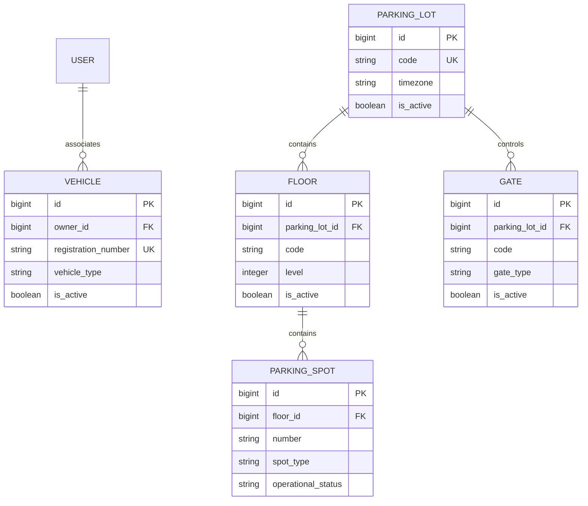

# ADR 0003: Parking configuration and account-associated vehicles

## Status

Accepted for Phase 3.

## Context

The system needs durable physical parking configuration before entry and allocation workflows can
be introduced. It also needs vehicles associated with customer accounts without implying that the
application has verified legal ownership.

## Decision

### Operational status is not occupancy

A spot has one configuration status: `ENABLED`, `MAINTENANCE`, or `DISABLED`. There is intentionally
no `OCCUPIED` value. Occupancy is time-varying session state and will be derived from active parking
sessions in Phase 4. Consequently, an enabled spot is operationally usable but is not necessarily
unoccupied. No live-availability endpoint exists in this phase.

### Capacity is derived

Physical capacity is calculated from configured `ParkingSpot` rows, optionally grouped by type or
operational status. No editable counter is stored because it could drift from the source rows during
creates, status changes, or future transactional allocation.

### Relationships are protected and configuration is deactivated

Floor-to-lot, gate-to-lot, spot-to-floor, and vehicle-to-owner foreign keys use `PROTECT`. Their
parents cannot be reassigned through the API, and Phase 3 exposes no DELETE routes. Lots, floors,
gates, and vehicles can be deactivated; spots change operational status. Deactivation preserves
child configuration. An inactive lot makes its floors, gates, and spots effectively unavailable,
and an inactive floor makes its spots effectively unavailable. Restrictions on changing occupied
spots will be introduced with parking sessions rather than guessed here.

### Vehicle ownership is API scope, not legal proof

`Vehicle.owner` is assigned exclusively from the authenticated user. Lists, retrievals, and updates
are scoped to that user; a cross-user identifier returns 404. ADMIN and OPERATOR roles receive no
special access to arbitrary vehicles in this phase. This association controls account access only
and does not prove legal ownership of a registration number.

Registration numbers are normalized by trimming, uppercasing, and removing spaces and hyphens. This
provides stable uniqueness for common formatting variants but is deliberately not presented as a
universal vehicle-plate validation rule.

## Data relationships

## Consequences

- PostgreSQL uniqueness and check constraints remain the final concurrency-safe protection.
- APIs translate known uniqueness violations to sanitized `409 Conflict` responses.
- Parent deactivation does not destroy or rewrite child records.
- Future session allocation can compute occupancy without migrating an overloaded spot-status field.

