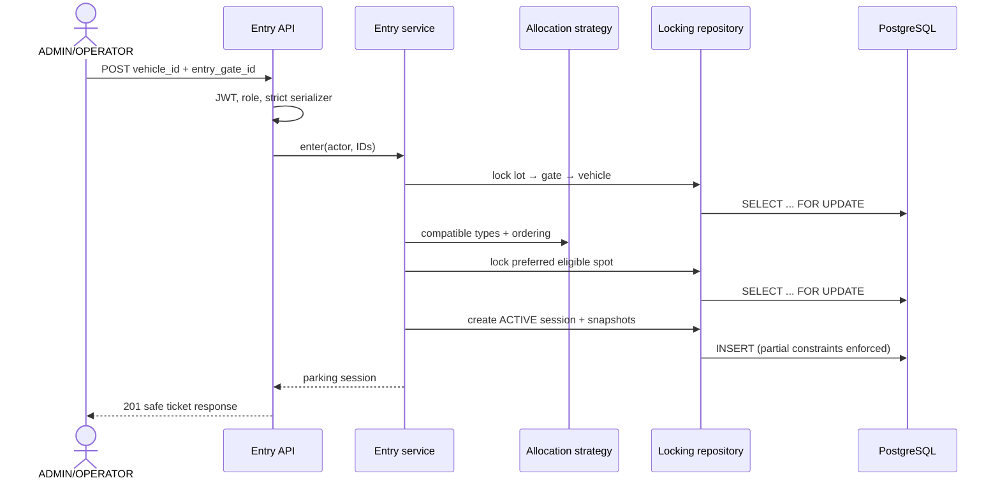
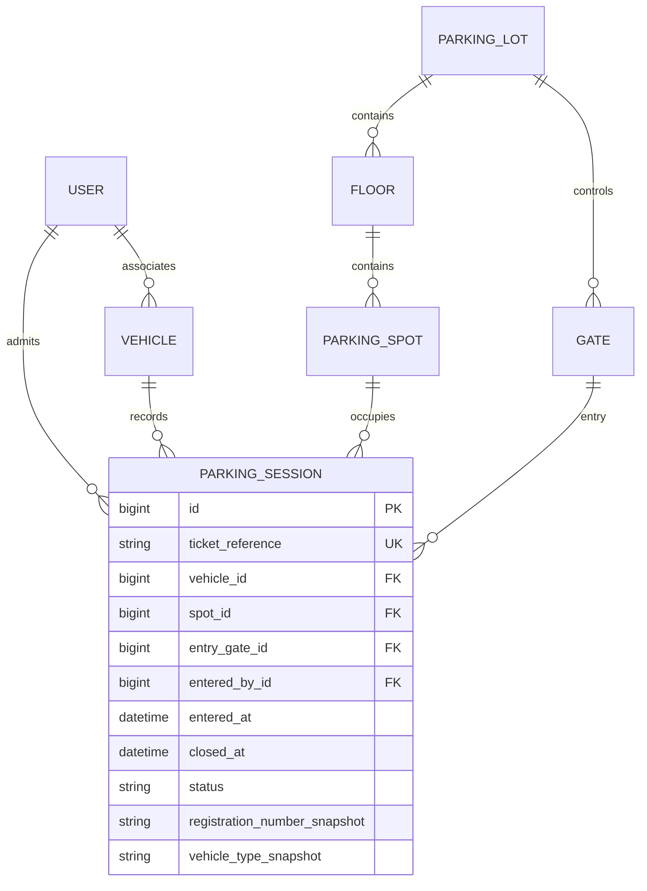

# ADR 0004: Transactional vehicle entry and availability

## Status

Accepted for Phase 4.

## Context

Vehicle entry must choose a compatible spot without admitting one vehicle twice or assigning one
spot twice when requests overlap. Configuration changes must not invalidate an in-progress
allocation. Availability must describe current state without pretending to reserve capacity.

## Decision

### Lock order and per-lot serialization

Entry operations lock rows in this order: parking lot, entry gate, vehicle, selected parking spot.
Relevant configuration mutations first lock the parking lot, then the descendant they mutate.
Vehicle identity mutations lock the vehicle. The entry service rechecks every eligibility rule
after acquiring its locks and creates the session in the same `transaction.atomic()` block.

The parking-lot row is a correctness-first serialization point for allocation and configuration in
that lot. It makes reasoning and deadlock avoidance straightforward, but it limits concurrent entry
throughput per lot. If measurement shows that this is a bottleneck, a later phase can introduce
finer-grained locking while retaining the database constraints and compatibility policy.

Cross-lot requests for the same vehicle serialize on the vehicle row. PostgreSQL is the source of
truth; Redis locks are not used.

### Partial unique constraints

PostgreSQL partial unique constraints allow at most one open session for a spot and at most one open
session for a vehicle. Open means `ACTIVE`, `PAYMENT_PENDING`, or `PAID`. These constraints protect
the invariant even if a future code path fails to follow the application lock protocol. Known
constraint conflicts are translated only after the failed atomic block has rolled back, so code
never queries through a broken transaction and raw database errors are not exposed.

### Operational status versus occupancy

`ParkingSpot.operational_status` remains configuration: `ENABLED`, `MAINTENANCE`, or `DISABLED`.
Occupancy is derived from an open `ParkingSession`. A maintenance spot can remain occupied when it
was changed after entry; the change blocks future allocation but neither closes nor releases the
existing session.

### Availability versus reservation

Availability is an informational aggregate from a single SQL statement. Available means an enabled
spot under an active floor and lot with no open session. Occupied means any open session, even when
the spot is now under maintenance or an inactive parent. Reading availability does not lock or
reserve anything. Only the transactional entry operation reserves a spot by creating a session.

### Compatibility and deterministic preference

The allocation strategy maps motorcycle to motorcycle, car to compact then large, and truck to
large. Within a compatible type it orders by floor level, spot number, then spot ID. Floor level is
a simple deterministic policy and does not claim to measure physical distance from an entry gate.
The strategy selects preference; the repository owns locking and persistence.

## Entry flow

## Updated data relationships

The session's lot is derived through `spot → floor → parking_lot`; no redundant lot foreign key is
stored.

## Consequences

- Entry is safe under concurrent requests at the cost of serializing entries per lot.
- Ticket references are server-generated and unguessable; snapshots preserve entry-time identity.
- Customers can read only sessions associated with their vehicles; operational staff can inspect
  all sessions without receiving nested account data.
- Checkout, exit, pricing, payment, caching, Redis, Celery, and idempotency keys remain out of scope.
