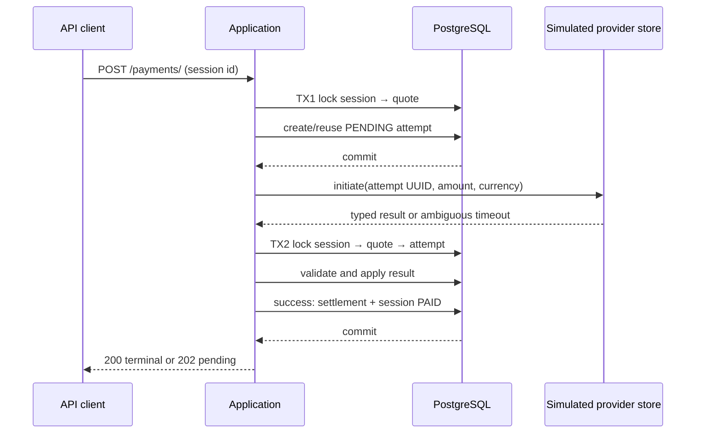
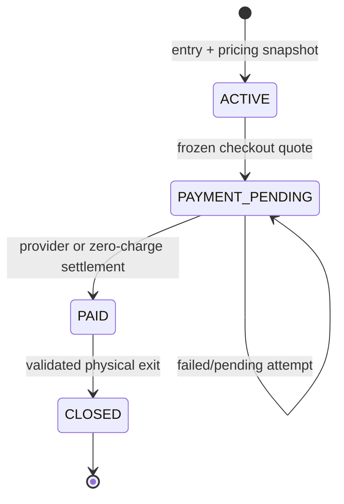
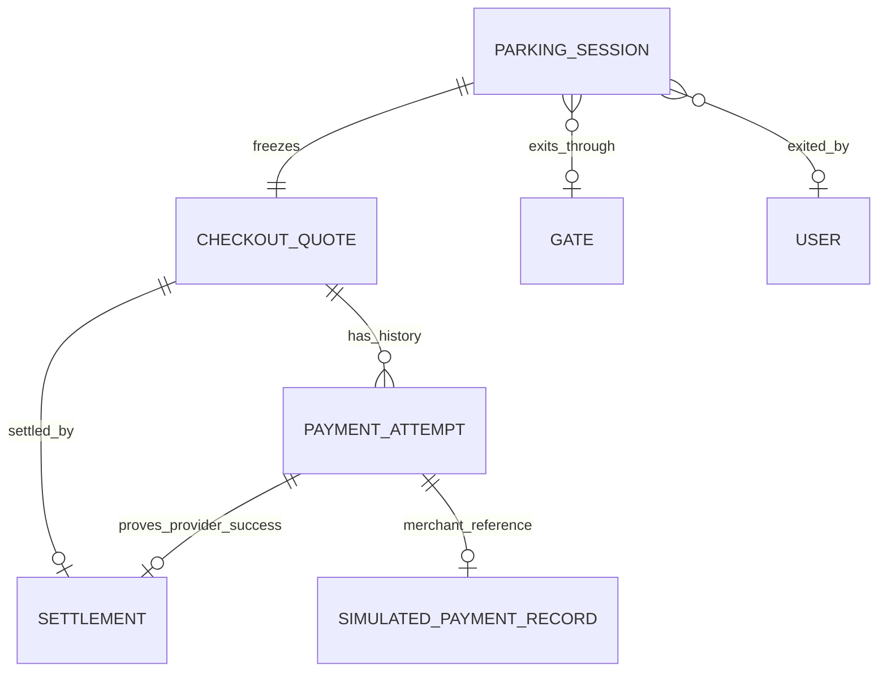

# ADR 0006: Simulated payments, settlement, and vehicle exit

## Status

Accepted for Phase 6.

## Context

Phase 5 freezes a deterministic checkout quote and leaves the parking session `PAYMENT_PENDING`.
Phase 6 must distinguish an interaction with a provider from authoritative settlement, recover
ambiguous outcomes, keep financial fields immutable, and release occupancy only after physical exit.
No real provider, webhook, background worker, refund, or general idempotency-key system is in scope.

## Decision

### Attempts and settlement

`PaymentAttempt` is an immutable-financial record for one merchant reference. Failed attempts remain
history, uncertain attempts remain `PENDING`, and database partial unique constraints permit at most
one pending and one successful attempt per quote. The attempt UUID is the merchant reference.

`Settlement` is the one-per-quote proof that money is resolved. `PROVIDER` requires a successful
attempt and a positive amount. `ZERO_CHARGE` requires no attempt and a zero amount. SQL checks enforce
same-row shape. Ordinary PostgreSQL checks cannot compare settlement values with another table or
inspect attempt status, so transactional services verify quote/attempt/settlement amount, currency,
ownership, and status under locks.

### Provider boundary and simulator

The payment service depends on the small `PaymentProvider` protocol. The simulated adapter stores
provider-side state in `SimulatedPaymentRecord`, isolated from domain attempts. This persistence gives
stable results across requests and workers. Scenarios come only from explicit development/test
configuration: success, failure, pending, and timeout after provider success. Public requests cannot
select an outcome.

The simulator demonstrates integration mechanics, not real gateway delivery, security, dispute,
latency, or consistency behavior.

### Transaction boundaries

Provider I/O is outside database transactions because network latency and failure must not hold row
locks or exhaust database concurrency. A timeout does not prove failure: the provider may have
committed success before the response was lost. The same attempt stays pending and reconciliation
retrieves by the original merchant reference.

### Result transitions

Allowed transitions are `PENDING → SUCCEEDED` and `PENDING → FAILED`. Identical terminal replays are
no-ops. Contradictory terminal results and mismatched merchant reference, amount, or currency are
explicit integrity errors. Success atomically marks the attempt succeeded, creates settlement, and
changes `PAYMENT_PENDING → PAID`. Failure leaves the session and quote unchanged.

### Zero-charge and exit

Zero quotes bypass the provider, create a `ZERO_CHARGE` settlement, and become `PAID`. Exit requires a
valid settlement and an active same-lot `EXIT` or `BOTH` gate. It locks session → gate → spot → quote
→ settlement → optional attempt, then stores exit gate, actor, and timestamp and transitions to
`CLOSED` atomically. Lot/floor inactivity and spot maintenance do not block exit.

`ACTIVE`, `PAYMENT_PENDING`, and `PAID` are open and occupy the spot. Only `CLOSED` releases it. No
independently maintained occupancy boolean exists.

### Data relationships

The simulator relationship is logical by merchant reference, not a domain foreign key.

## Migration of historical closed sessions

Exit actor and gate cannot be inferred safely. The migration adds nullable columns, detects existing
`CLOSED` sessions, and fails with an actionable message before adding the strict lifecycle constraint.
Operators must use verified historical records to resolve them before retrying. The migration never
chooses a fake gate or user. Open sessions migrate directly because their exit metadata must be null.

## Consequences

- Payment retries and reconciliation share one result-processing path.
- Financial and lifecycle changes are auditable and concurrency-safe.
- Provider latency never extends a database lock transaction.
- `PAID` explicitly means settled but still physically parked.
- Real gateway semantics, webhooks, refunds, and automated reconciliation remain future work.
