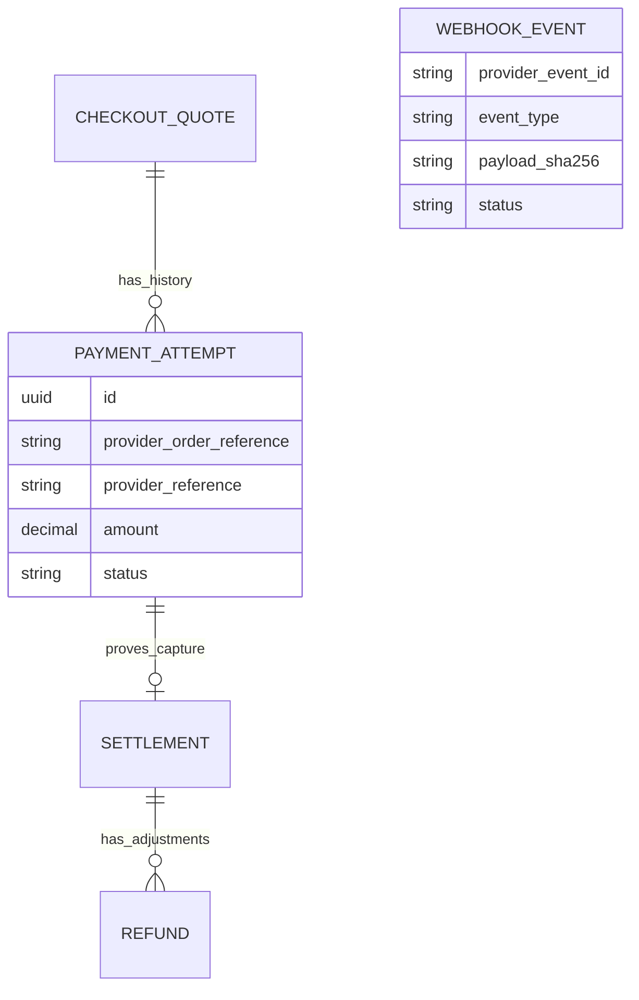

# ADR 0007: Razorpay payments, webhooks, reconciliation, and refunds

## Status

Accepted as the real-provider extension to Phase 6.

## Context

The simulator proves application state transitions but cannot accept real payment methods or model
provider delivery. The application needs an India-oriented gateway while preserving frozen quotes,
the one-settlement invariant, short database transactions, and uncertain-outcome safety.

## Decision

### Provider and checkout boundary

Razorpay is selected because the current pricing currency is INR. The official Python SDK is wrapped
behind the existing provider protocol. Local and automated-test configuration remains `SIMULATED`;
production must explicitly select a provider, and Razorpay selection fails startup when the API key,
API secret, or independent webhook secret is absent.

The server creates an Order using the attempt UUID as a stable, unique receipt. The browser receives
only the public key ID and Order ID. Standard Checkout owns sensitive payment-method collection. The
API key secret and webhook secret remain server-side.

```mermaid
sequenceDiagram
    participant UI as Client + Razorpay Checkout
    participant API as Django API
    participant DB as PostgreSQL
    participant RZP as Razorpay
    UI->>API: POST /payments/ (session id)
    API->>DB: TX1 lock session → quote; create PENDING attempt
    API->>RZP: Create Order outside transaction
    RZP-->>API: order_id
    API->>DB: TX2 validate and save order_id
    API-->>UI: attempt, public key, order_id, frozen amount
    UI->>RZP: Standard Checkout
    RZP-->>UI: payment_id, order_id, signature
    UI->>API: POST /payments/{id}/confirm/
    API->>RZP: verify signature + fetch payment
    API->>DB: captured only: attempt + settlement + PAID atomically
```

The confirmation signature proves the callback fields are authentic; it is not itself proof of
capture. The adapter fetches the payment and verifies captured status, order, amount, and currency.

### Webhooks

Webhooks are the durable automation path. HMAC is checked over the exact raw body before JSON parsing.
`X-Razorpay-Event-Id` plus provider is unique in PostgreSQL, so duplicate deliveries are no-ops.
Only metadata and a payload digest are retained. Authoritative payment/refund state is fetched from
Razorpay rather than trusting mutable payload fields. Unsupported events are recorded as ignored;
domain contradictions are recorded as failed for investigation.

### Unknown outcomes and reconciliation

Provider I/O never occurs while application rows are locked. A timeout means unknown, not failed.
The attempt or refund remains pending. `reconcile_payment` uses the stored Order/Payment ID, or finds
an Order by its unique UUID-derived receipt after an order-create timeout, and then invokes the same
transactional result service as confirmation and webhooks.

Razorpay refunds use the refund UUID in provider notes. When refund creation times out before the
provider ID is received, operators must locate that reference in the Dashboard; automatically
issuing another refund could duplicate money movement. Once known, `reconcile_refund` safely fetches
and applies its current state.

### Refund ledger

Refunds are append-only financial operations linked to the original immutable settlement. They have
server-owned amount, currency, status, provider reference, requester, timestamps, and failure code.
An administrator can request full or partial refunds. Under a settlement row lock, pending and
successful refunds reserve value, so their sum cannot exceed the settled amount even concurrently.
Failed refunds remain history but release their reserved amount.

Refunding money does not erase settlement, reopen a parking session, or change occupancy. Those are
separate operational facts. Chargebacks and disputes are deliberately not modeled as refunds.

### Data relationships



## Consequences

- The backend can drive Razorpay Test or Live Mode without receiving raw payment credentials.
- Browser confirmation, webhook delivery, and manual reconciliation converge on shared result logic.
- Duplicate webhook deliveries and repeated terminal results are safe.
- The database prevents over-refund within application-controlled flows; provider-side manual
  refunds must be reconciled operationally.
- Real charges, refunds, settlement timing, disputes, and bank behavior still require staged Razorpay
  account testing and monitoring; deterministic unit tests cannot certify the external provider.
